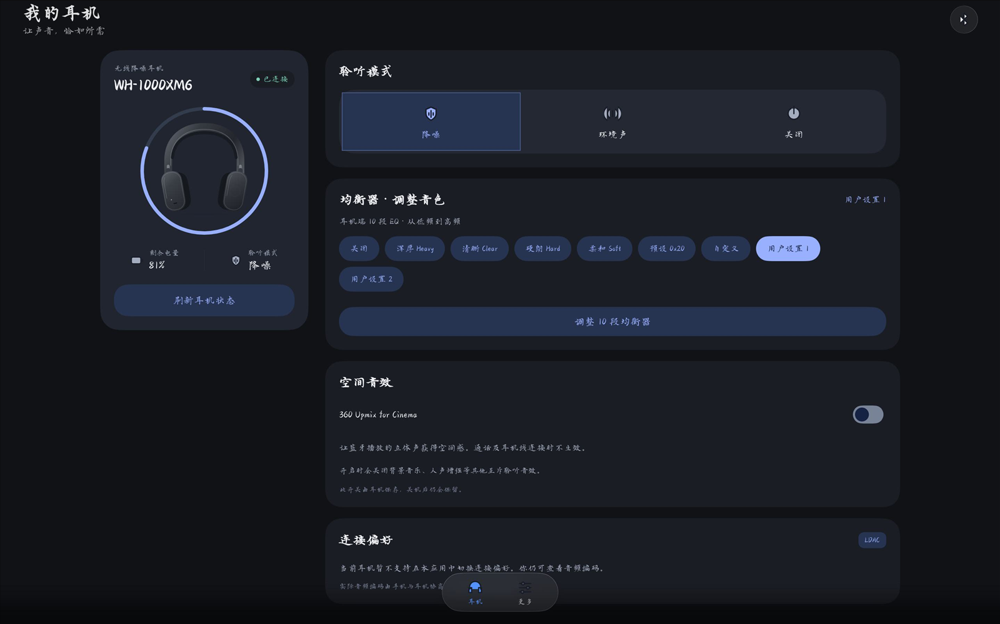
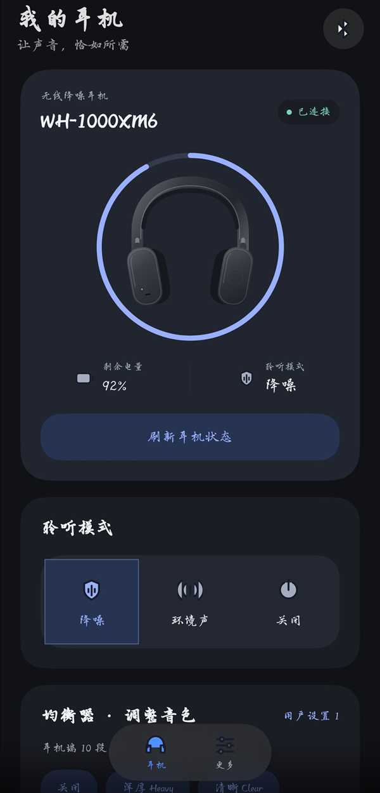

# Sony Headphones Assistant for HarmonyOS

English · [简体中文](README.zh-CN.md)

Switch listening modes, adjust the equalizer, and check your Sony headphones' battery from a HarmonyOS phone or tablet. Sony lists its Sound Connect app for Android and iOS. This community app brings those everyday controls to HarmonyOS over the headphones' Bluetooth MDR V2 protocol. [Sony Sound Connect installation guide](https://helpguide.sony.net/mdr/2984/v1/en/contents/TP1001856853.html)

**Version 0.5.0** · **No Internet permission** · [Install](#install) · [What's new](CHANGELOG.md)

[](docs/screenshots/tablet.png)

Tablet view. The app interface is currently in Simplified Chinese.

## Install

Installation currently requires a Windows PC and DevEco Studio. There is no AppGallery release or public installer.

1. On GitHub, open **Code** to clone the repository or choose **Download ZIP**. Follow [Building locally](#building-locally) to set up the SDK and initialize the project.
2. Open the project in DevEco Studio, connect your device over USB, and enable USB debugging. Set up debug signing for that device under **Project Structure → Signing Configs**, then click **Run**. [Huawei device debugging guide](https://developer.huawei.com/consumer/cn/doc/harmonyos-faqs/app-debugging-faq-0005/)

If you already have a HAP signed for your device, run `hdc install -r <path-to-signed.hap>` with Huawei Device Connector. [HDC installation reference](https://developer.huawei.com/consumer/en/doc/harmonyos-guides/hdc/)

The configured minimum is **HarmonyOS 6.0 (API 20)**. Physical-device testing has covered HarmonyOS 7. Testing on 6.0 is pending.

## Using the app

- Pair and connect your headphones in system Bluetooth settings, then open the app. Auto-reconnect is enabled by default and gives priority to the last headset used. If several headsets are available and there is no preferred device, select one in the app.
- Long-press the app icon to add a home screen widget. It shows the battery level and listening mode while connected. The readings are hidden when disconnected. Tap the widget to reconnect.
- Choose a light or dark appearance, follow the system appearance, or change the accent color under **More → Appearance** (「更多 → 外观」).

<p align="center">
  <a href="docs/screenshots/phone.png"></a>
</p>

## Headphone compatibility

| Model | Verification |
| --- | --- |
| WH-1000XM6 | Tested on a HarmonyOS phone and tablet. The app reads battery, firmware, and active codec, switches between noise canceling, ambient sound, and off, and exposes the headset's 10-band EQ. |
| WF-1000XM5 | Left earbud, right earbud, and case battery readings verified through packet replay. All features are still awaiting HarmonyOS hardware testing. |
| Other Sony models | Controls depend on the device's reported MDR V2 capabilities. Model-by-model verification is pending. |

See the [device test notes](docs/DEVICE_TEST_2026-11-07.md) in Chinese for the tested setup and scope.

## Current limits

- Listening mode selection and ambient sound level are available on supported headsets. Manual ANC strength control is unavailable. [ANC investigation](docs/XM6_MANUAL_ANC_RESEARCH.md)
- The app displays the active codec reported by the headset. It has no controls for LDAC bitrate, LE Audio, multipoint connections, wear detection, DSEE, or Sony's activity- and location-based Adaptive Sound Control. Automatic ambient sound is available on headsets that report support for it.
- Firmware updates and legacy MDR V1 models are unsupported. [Firmware update investigation](docs/FIRMWARE_UPDATE_FEASIBILITY.md)

## Privacy and permissions

Bluetooth access (`ACCESS_BLUETOOTH`) lets the app find and control paired headphones. Background running (`KEEP_BACKGROUND_RUNNING`, `bluetoothInteraction`) lets an active control connection keep syncing the widget while the app is in the background, subject to system limits. Disconnecting in the app stops that session.

Appearance preferences, the last headset identifier, and widget readings stay on the device. Connection logs are kept in memory.

## Building locally

Install DevEco Studio with the HarmonyOS API 26 SDK, which the build targets. Run the following commands from the repository root in Windows PowerShell.

```powershell
.\build.ps1 -CheckOnly
.\build.ps1
```

The first command runs the protocol, widget, and reconnection checks without a device or signing credentials. The second initializes the local configuration from `build-profile.example.json5` and builds a debug HAP. For a custom DevEco Studio installation, pass `-ToolHome 'path to DevEco Studio'` or set `DEVECO_STUDIO_HOME`.

With debug signing configured, the build writes `entry/build/default/outputs/default/entry-default-signed.hap`. Git ignores local signing configuration, keys, and build packages.

## Credits

- **Adapted code.** Parts of the MDR protocol implementation and Bluetooth RFCOMM connection handling were ported or adapted from **SonyHeadphonesClient** by mos9527, Amr Satrio, and contributors. Those portions retain their upstream MIT license. [Upstream repository](https://github.com/mos9527/SonyHeadphonesClient)
- **Protocol and test data.** The WF-1000XM5 battery tests replay upstream captures from SonyHeadphonesClient. The WH-1000XM6 10-band equalizer implementation was checked against the packet data documented by sony-device-center. [sony-device-center PR #44](https://github.com/marconvcm/sony-device-center/pull/44)

OpenAI Codex assisted with this project's code, interface, and documentation. The maintainer provided requirements, test devices, and feedback.

Sony and model names identify compatible hardware. This independent project has no affiliation with Sony or Huawei.

## License

The portions adapted from SonyHeadphonesClient retain their MIT license and copyright notices. The maintainer has not yet selected a license for this project's original work. [Source files, upstream revisions, and full license notice](THIRD_PARTY_NOTICES.md)
