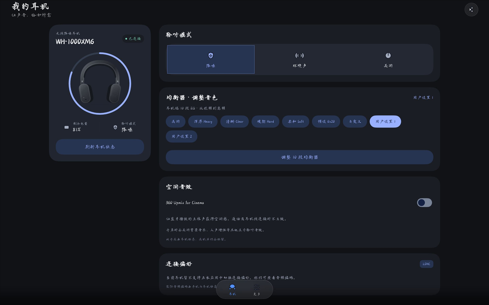
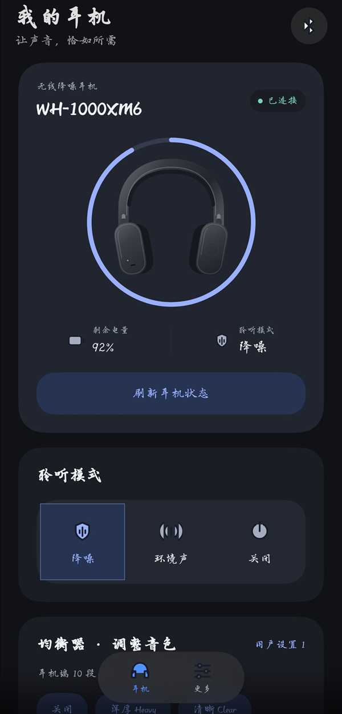

# 索尼耳机助手 · HarmonyOS

[English](README.md) · 简体中文

在鸿蒙手机和平板上切换聆听模式、调均衡器、看索尼耳机电量。索尼官方 Sound Connect 提供 Android 和 iOS 版本。这个社区应用通过耳机的蓝牙 MDR V2 协议，把这些日常控制带到鸿蒙上。[索尼 Sound Connect 安装说明](https://helpguide.sony.net/mdr/2984/v1/zh-cn/contents/TP1001856687.html)

**当前版本 0.5.0** · **无网络权限** · [安装](#安装) · [更新记录](CHANGELOG.md)

[](docs/screenshots/tablet.png)

## 安装

下载 [0.5.0 未签名 HAP](https://github.com/wadasudent/sony-headphones-harmony/releases/download/v0.5.0/XM6Harmony-0.5.0-unsigned.hap)，为自己的设备配置调试签名后即可安装。

[v0.5.0 发布说明](https://github.com/wadasudent/sony-headphones-harmony/releases/tag/v0.5.0) 提供第三方工具「小白调试助手」的签名步骤和 SHA-256 校验值。签名需要登录华为开发者账号。华为应用签名指南列出的调试证书有效期为未实名 14 天、已实名 1 年，具体以签发证书的到期日期为准。[华为调试证书说明](https://developer.huawei.com/consumer/cn/doc/app/agc-help-add-debugcert-0000001914263178/)

如需从源码构建并签名，请在 Windows 上使用 DevEco Studio。

1. 在 GitHub 的 **Code** 菜单克隆仓库或选择 **Download ZIP**。按[本地构建](#本地构建)一节配置 SDK、初始化项目。
2. 用 DevEco Studio 打开项目，将开启 USB 调试的设备连接到电脑。在 **Project Structure → Signing Configs** 为该设备配置调试签名，点击 **Run** 安装。[华为真机调试指南](https://developer.huawei.com/consumer/cn/doc/harmonyos-faqs/app-debugging-faq-0005/)

已有适用于该设备的签名 HAP 时，也可以执行 `hdc install -r <签名包路径>` 覆盖安装。[HDC 安装文档](https://developer.huawei.com/consumer/cn/doc/harmonyos-guides/hdc/)

配置的最低系统版本为 **HarmonyOS 6.0（API 20）**。已在 HarmonyOS 7 上实测，6.0 待测。

## 使用

- 在系统蓝牙设置中配对并连接耳机，再打开助手。智能重连默认开启，优先接入上次使用的耳机。有多副可选设备且无优先设备时，请在应用内选择。
- 长按应用图标添加服务卡片。卡片显示电量和聆听模式，断链时隐藏读数，点按可重连。
- 在「更多 → 外观」选择深浅色模式和强调色。

<p align="center">
  <a href="docs/screenshots/phone.png"></a>
</p>

## 耳机兼容性

| 型号 | 当前验证情况 |
| --- | --- |
| WH-1000XM6 | 已在鸿蒙手机和平板上实测。可读取电量、固件和当前编码，切换降噪、环境声或关闭，并提供耳机端十段均衡器。 |
| WF-1000XM5 | 仅左耳、右耳和充电盒电量通过报文回放验证，各项功能均待鸿蒙真机确认。 |
| 其他索尼耳机 | 按设备报告的 MDR V2 能力显示功能，待逐型号验证。 |

测试设备和验证范围见[真机测试记录](docs/DEVICE_TEST_2026-11-07.md)。

## 当前功能边界

- 支持的型号可切换聆听模式和调整环境声强度。暂不支持手动调整主动降噪强度。[手动降噪档位调查](docs/XM6_MANUAL_ANC_RESEARCH.md)
- 可以查看耳机报告的当前音频编码。暂未提供 LDAC 码率、LE Audio、多点连接、佩戴检测、DSEE 或索尼基于活动和位置的自适应声音控制。耳机报告支持时，应用提供自动环境声设置。
- 暂不支持固件升级和旧款 MDR V1 耳机。[固件升级调查](docs/FIRMWARE_UPDATE_FEASIBILITY.md)

## 隐私与权限

蓝牙权限（`ACCESS_BLUETOOTH`）用于查找和控制已配对耳机。后台运行权限（`KEEP_BACKGROUND_RUNNING`、`bluetoothInteraction`）用于在退到后台后维持当前的耳机控制连接，继续同步服务卡片，实际运行受系统限制。在应用内断开连接会结束这项后台任务。

外观偏好、上次耳机标识和卡片读数保存在本机，连接日志仅存于内存。

## 本地构建

安装 DevEco Studio 和项目编译使用的 HarmonyOS API 26 SDK。在 Windows PowerShell 的项目根目录运行以下命令。

```powershell
.\build.ps1 -CheckOnly
.\build.ps1
```

第一条运行协议、卡片和重连检查，无需设备或签名。第二条从 `build-profile.example.json5` 初始化本地配置，构建调试 HAP。自定义安装位置可通过 `-ToolHome '你的 DevEco Studio 安装目录'` 指定，或设置 `DEVECO_STUDIO_HOME`。

配置调试签名后，构建输出为 `entry/build/default/outputs/default/entry-default-signed.hap`。本地签名配置、密钥和安装包均由 Git 忽略。

## 作者与致谢

- **移植代码。** MDR 协议和蓝牙 RFCOMM 连接处理的部分代码移植或改编自 **SonyHeadphonesClient**，作者为 mos9527、Amr Satrio 及贡献者。这些代码保留上游 MIT 许可。[上游仓库](https://github.com/mos9527/SonyHeadphonesClient)
- **协议参考和测试数据。** WF-1000XM5 电量测试使用 SonyHeadphonesClient 的上游抓包。WH-1000XM6 十段均衡器实现对照了 sony-device-center 公布的报文。[sony-device-center PR #44](https://github.com/marconvcm/sony-device-center/pull/44)

本项目的代码、界面和文档由 OpenAI Codex 辅助开发，维护者提供需求、测试设备和使用反馈。

文中的索尼品牌与型号名称用于说明适用设备。本项目独立开发，与索尼、华为无官方关联。

## 许可

来自 SonyHeadphonesClient 的改编部分保留 MIT 许可和原有版权声明。项目原创部分的许可证尚待确定。[引用文件、上游提交和完整许可声明](THIRD_PARTY_NOTICES.md)
